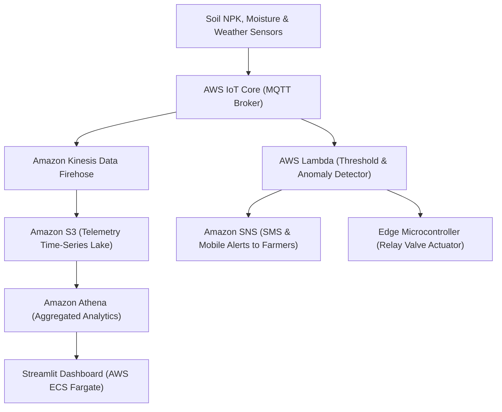

# AgriSmart Precision Irrigation — IoT Telemetry & Agronomic AI

> IoT-driven soil telemetry, evapotranspiration modeling, and automated valve actuation system delivering optimized water conservation for precision agriculture.

---

## 1. Executive Brief
Over-irrigation depletes water tables and leaches vital soil nitrogen. **AgriSmart Precision Irrigation** continuously streams moisture, temperature, humidity, and rainfall readings to predict water requirements 24-hours ahead, automating solenoid valve relays with zero manual intervention.

* **Preservation**: Original AICTE/Edunet project preserved on [`Ex`](https://github.com/prak05/AgriSmart-Precision-Irrigation/tree/Ex).
* **Cloud Architecture**: AWS IoT Core telemetry ingestion, Amazon Kinesis Firehose, and Streamlit executive dashboard.

---

## 2. AWS Cloud Architecture

---

## 3. Branch Architecture
* [`main`](https://github.com/prak05/AgriSmart-Precision-Irrigation/tree/main): IoT Core telemetry pipeline with AWS Lambda automation.
* [`Ex`](https://github.com/prak05/AgriSmart-Precision-Irrigation/tree/Ex): Preserved student project prototype.
